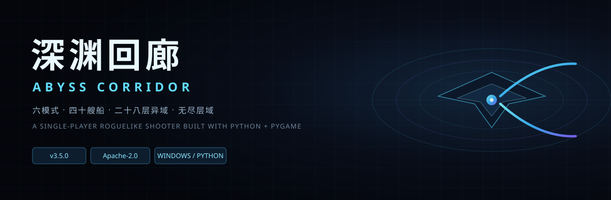
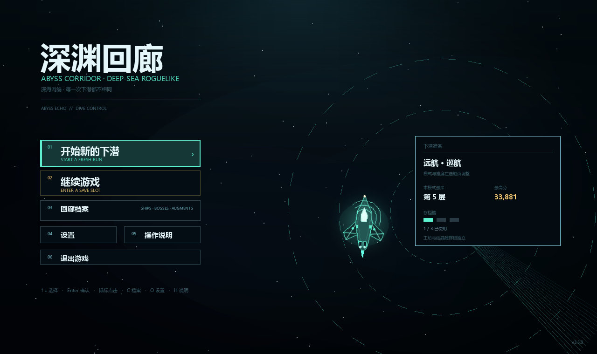
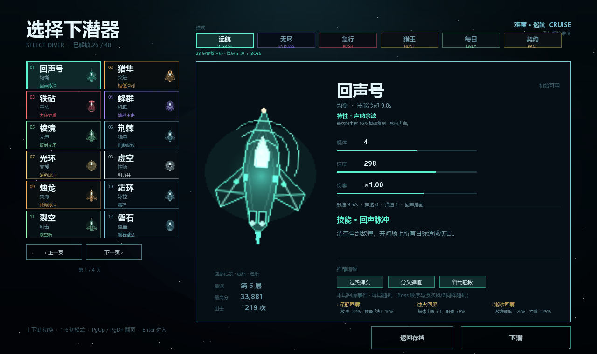
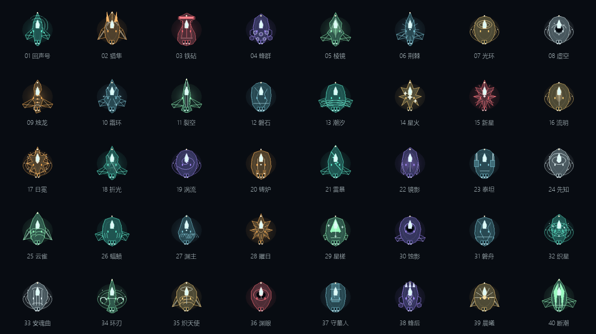
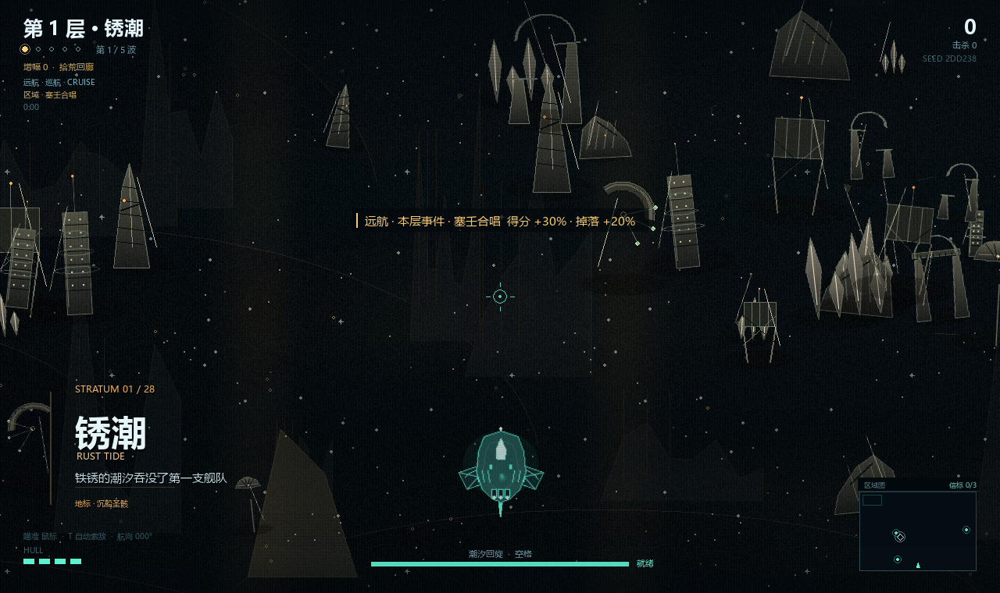
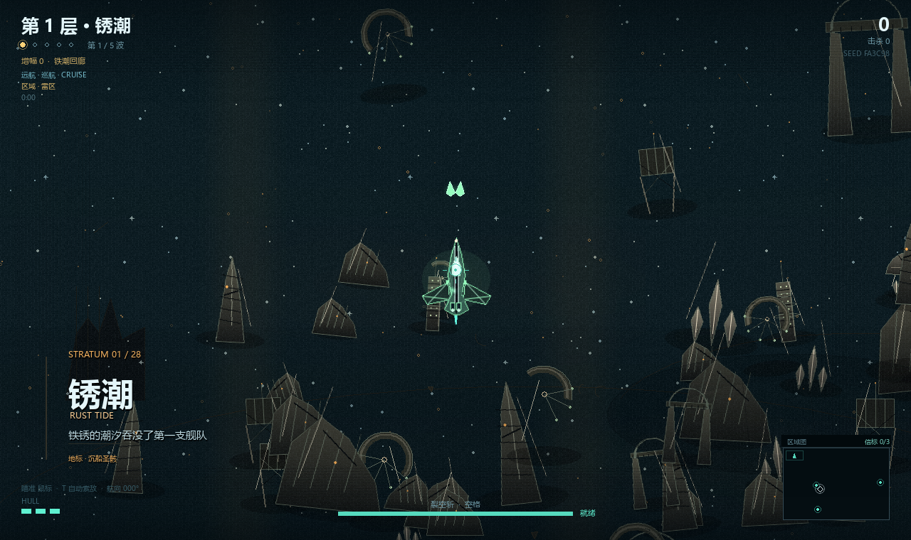
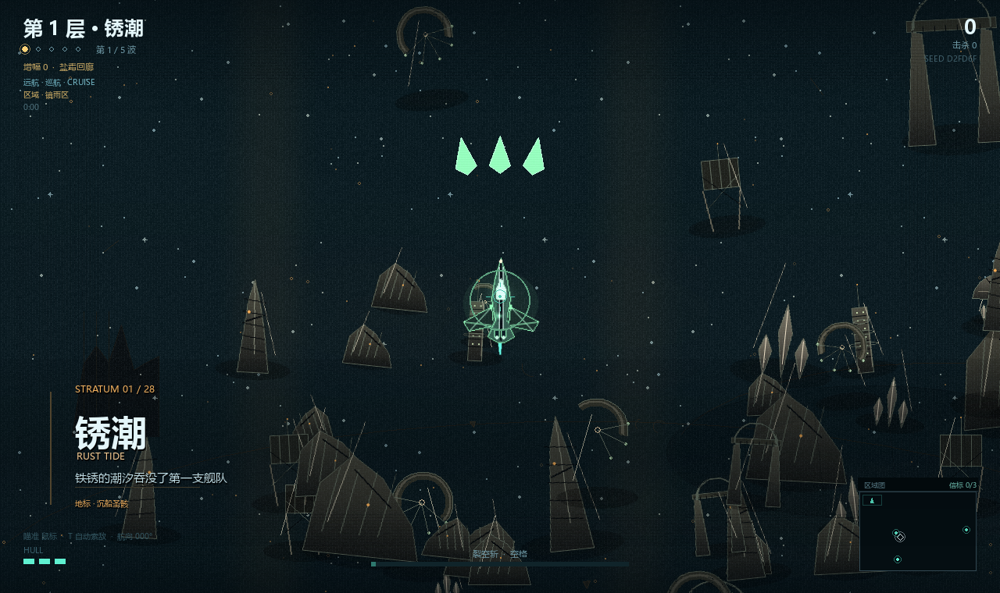

<div align="center">
  
</div>

<p align="center">
  <b>Six modes · Forty ships · Twenty-eight strata · Endless descent</b><br>
  A single-player roguelike shooter written from scratch with Python + pygame.
</p>

<p align="center">
  <a href="https://github.com/Yonh-Ctrl/abyss-corridor-game/releases/latest"><b>Download from Releases</b></a>
  ·
  <a href="README.md">中文</a>
</p>

> **Playable build:** `AbyssCorridor-v3.5.0-win64.zip`. Unzip and run `AbyssCorridor.exe`; Python is not required.  
> See the [Releases](https://github.com/Yonh-Ctrl/abyss-corridor-game/releases) page for the SHA256 and package contents.

## What is this?

**Abyss Corridor (深渊回廊)** is a 2D top-down roguelike shooter. The maps, ships, enemies, bullets, glows, patterns and most UI are drawn procedurally in code; sound effects and BGM are synthesized at runtime.

- **6 modes**: Voyage, Endless, Rush, Hunt, Daily, Pact
- **28 themed strata + endless mode**: large scrolling maps, rotating events and bosses
- **40 playable ships**: each has its own model, identity and base bullet pattern
- **17 base patterns**: direct, spread, orbit, boomerang, heavy, moon blade, and more
- **196 augments, 73 layer events, 76 mutations, 12 pacts, 55 achievements, 28 bosses, 36 enemy types**
- **3 save slots, Chinese/English UI, gamepad support, mouse aim / auto-aim**
- **v3.5.0 skill fix**: the Rift hull fires two crossing blades; the Rift skill is the three large blades. Lark, Glaive and Breakwater use different skill forms.

## Screenshots

| Title / modes | Ship select |
| --- | --- |
|  |  |

| 40 ship models | Gameplay |
| --- | --- |
|  |  |

| Rift base: two crossing blades | Rift skill: three large blades |
| --- | --- |
|  |  |

## Quick start

### Windows portable build

1. Download `AbyssCorridor-v3.5.0-win64.zip`
2. Unzip into any writable folder
3. Run `AbyssCorridor.exe`

No Python installation is needed. Saves and settings stay inside the game folder.

### Run from source

```powershell
git clone https://github.com/Yonh-Ctrl/abyss-corridor-game.git
cd abyss-corridor-game
python -m venv .venv
.venv\Scripts\activate
pip install -r requirements.txt
python abyss_corridor.py
```

Python 3.10+ is required; Python 3.13 is recommended. The only dependency is `pygame`.

> The repository ships pre-generated SFX, BGM and voice files in `assets/`. If you remove them, the game synthesizes SFX and BGM into `saves/audio_cache/` on first run and remains playable without voice lines.

## Controls

| Action | Input |
| --- | --- |
| Move | `WASD` / left stick |
| Aim | Mouse / right stick |
| Main guns | Auto-fire |
| Skill | `Space` / gamepad A / RT |
| Auto-aim | `T` / gamepad Y |
| Slow move | `Shift` / LB |
| Pause / menu | `Esc` / Start |
| Mute | `M` |
| Fullscreen | `F11` |
| Settings / archive / manual | `O` / `C` / `H` |

## Build

The repository includes `.github/workflows/build-release.yml`: pushing a `v*` tag builds an onedir Windows package with PyInstaller and creates a GitHub Release.

Local build:

```powershell
pip install -r requirements.txt pyinstaller
pyinstaller --noconfirm --clean --windowed --onedir --name AbyssCorridor abyss_corridor.py
```

The runnable folder is `dist/AbyssCorridor/`.

## Project layout

```text
abyss-corridor-game/
├─ abyss_corridor.py          # single-file game source (~12k lines)
├─ requirements.txt
├─ assets/                    # pre-generated SFX, BGM, voice
├─ docs/                      # banner, architecture, screenshots, release notes
├─ .github/workflows/         # Windows build + release
├─ LICENSE                    # Apache-2.0
├─ NOTICE
└─ CHANGELOG.md
```

Key entry points:

- `boot()`: window, fonts, audio and saves
- `new_run()` / `update()` / `draw_scene()`: run state, logic and rendering
- `do_fire()`: base bullet patterns
- `cast_skill()`: ship skills
- `draw_bullets()`: bullets and blade rendering
- `SHIP_LOOKS` / `SHIP_IDENTITIES` / `SHIP_PATTERN_NAMES`: the 40-ship mapping

See [docs/ARCHITECTURE.md](docs/ARCHITECTURE.md) for details.

## Scope

- Single-player only: no networking, accounts, IAP or cross-play.
- No commercial engine; rendering, particles and most UI are immediate-mode pygame drawing.
- Test saves, old builds and build caches are intentionally excluded.
- If you contribute third-party art or audio, make sure you have the right to publish it under Apache-2.0, or mark its license explicitly in the PR.

## Contributing

Issues and pull requests are welcome. Good starting points:

- new ships, bullet patterns or boss behaviors
- balance and difficulty curves
- English copy and translation fixes
- gamepad, resolution, accessibility and performance
- new layer events, mutations and pact combinations

Before submitting, run:

```powershell
python -m py_compile abyss_corridor.py
python abyss_corridor.py --selftest
```

## License

Code and original project content are released under the **Apache License 2.0**. See [LICENSE](LICENSE) and [NOTICE](NOTICE).

Game names, ship names, lore text and original visual assets belong to the project author; please credit the source when reusing.

## Credits

- [pygame](https://www.pygame.org/) for the 2D game layer
- everyone who playtested, reported bugs and discussed balance

If you find this useful, a Star or a playtest issue is appreciated.
