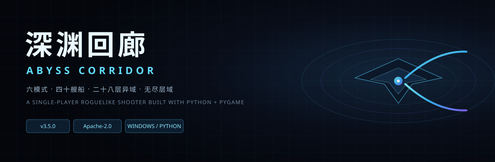
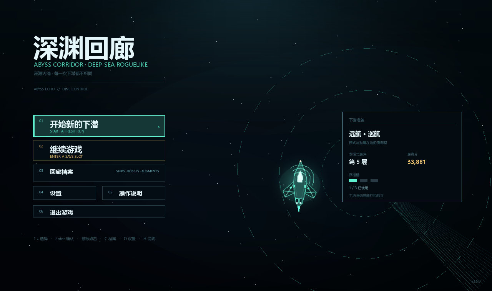
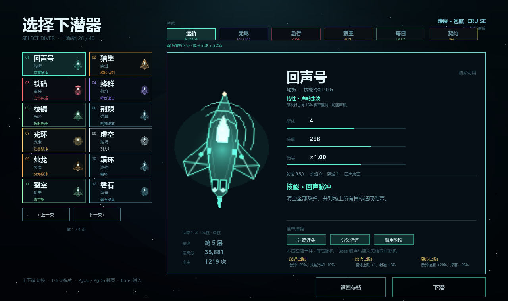
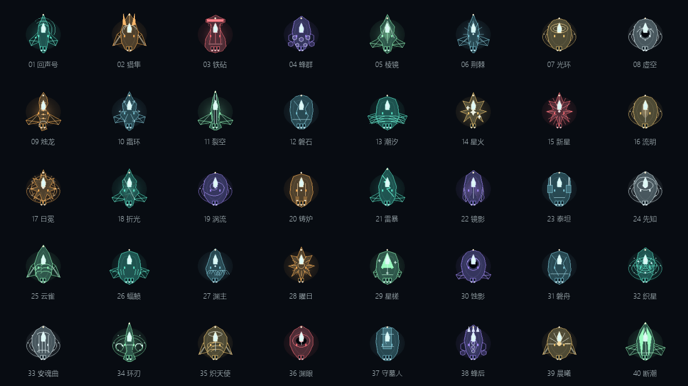
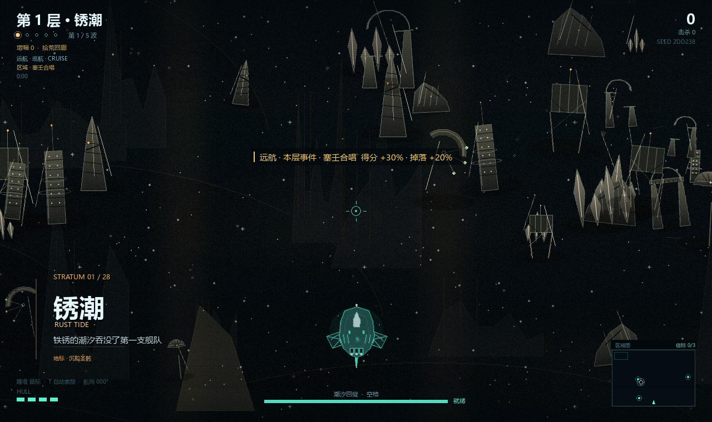
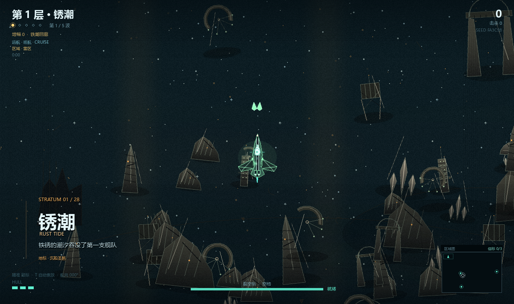
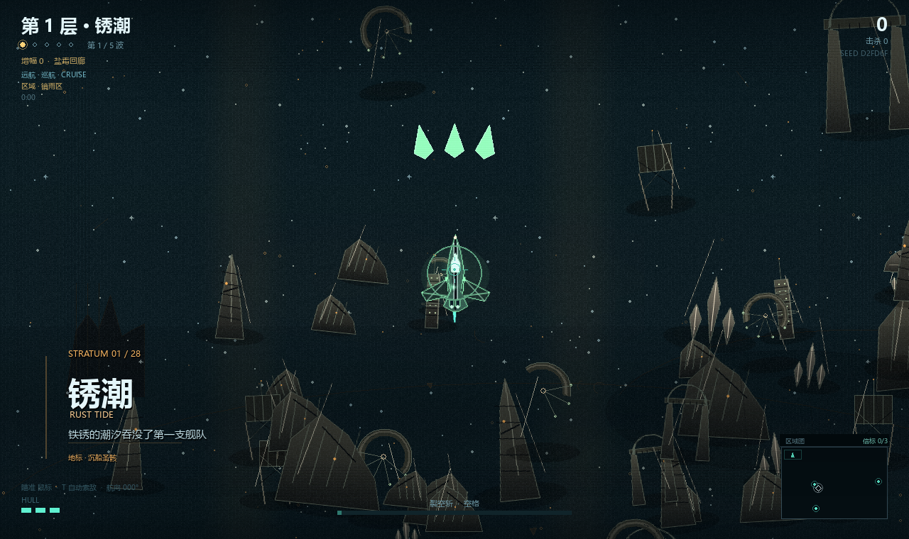

<div align="center">
  
</div>

<p align="center">
  <a href="https://github.com/Yonh-Ctrl/abyss-corridor-game/releases"></a>
  
  
  
  <a href="LICENSE"></a>
</p>

<p align="center">
  <b>六模式 · 四十艘船 · 二十八层异域 · 无尽层域</b><br>
  一款用 Python + pygame 从零写成的单机肉鸽射击游戏。
</p>

<p align="center">
  <a href="https://github.com/Yonh-Ctrl/abyss-corridor-game/releases/latest"><b>GitHub Releases 下载</b></a>
  ·
  <a href="README.en.md">English</a>
</p>

> **当前可玩包**：`AbyssCorridor-v3.5.0-win64.zip`，解压后直接运行 `AbyssCorridor.exe`，不需要安装 Python。  
> SHA256 与包内容见 [Releases](https://github.com/Yonh-Ctrl/abyss-corridor-game/releases) 页面。

---

## 这是什么

《深渊回廊》是一个不依赖商业引擎和第三方美术素材的 2D 俯视角肉鸽射击游戏。地图、飞船、敌机、弹幕、光晕、纹样和大部分界面都由代码实时绘制，音效与 BGM 由程序合成。

- **6 种模式**：远航、无尽、急行、猎王、每日、契约
- **28 层异域 + 无尽层域**：每层一张大地图，镜头跟随，主题、事件和 BOSS 轮换
- **40 艘可玩飞船**：每艘船有独立模型、特性名和基础弹道
- **17 种基础弹道**：直射、扇形、环绕、回旋、重炮、月刃等
- **196 项增幅、73 个层事件、76 条突变、12 份契约、55 个成就、28 个 BOSS、36 种敌机**
- **三存档槽、中英文界面、手柄支持、鼠标瞄准 / 自动索敌**
- **v3.5.0 技能修正**：裂空本体是两道交叉月刃，裂空斩才是三道大月刃；云雀、环刃、断潮使用不同的技能形态

## 截图

| 标题与模式 | 选船与模型 |
| --- | --- |
|  |  |

| 40 艘船模型总览 | 实机 |
| --- | --- |
|  |  |

| 裂空本体：两道交叉小月刃 | 裂空斩：三道大型月刃 |
| --- | --- |
|  |  |

## 快速开始

### Windows 免安装包

1. 下载 `AbyssCorridor-v3.5.0-win64.zip`
2. 解压到任意可写目录
3. 双击 `AbyssCorridor.exe`

不需要安装 Python。首次启动会在游戏目录生成 `saves/`，存档和设置都留在绿色版目录内。

### 从源码运行

```powershell
git clone https://github.com/Yonh-Ctrl/abyss-corridor-game.git
cd abyss-corridor-game
python -m venv .venv
.venv\Scripts\activate
pip install -r requirements.txt
python abyss_corridor.py
```

要求 Python 3.10+，推荐 Python 3.13；依赖只有 `pygame`。

> 仓库包含 `assets/audio` 与 `assets/voice` 预生成音频；如果删除，游戏会在首次运行时自动合成音效与 BGM 到 `saves/audio_cache/`，没有语音时也能正常游玩。

## 操作

| 操作 | 键位 |
| --- | --- |
| 移动 | `WASD` / 左摇杆 |
| 瞄准 | 鼠标 / 右摇杆 |
| 主炮 | 自动开火 |
| 技能 | `空格` / 手柄 A / RT |
| 自动索敌 | `T` / 手柄 Y |
| 减速穿弹 | `Shift` / LB |
| 暂停 / 菜单 | `ESC` / Start |
| 静音 | `M` |
| 全屏 | `F11` |
| 设置 / 档案 / 说明 | `O` / `C` / `H` |

## 构建 Windows 包

仓库自带 `.github/workflows/build-release.yml`：推送 `v*` 标签时，GitHub Actions 会在 Windows 上安装 Python、pygame 和 PyInstaller，构建 onedir 包并创建 Release。

本地构建：

```powershell
pip install -r requirements.txt pyinstaller
pyinstaller --noconfirm --clean --windowed --onedir --name AbyssCorridor abyss_corridor.py
```

产物在 `dist/AbyssCorridor/`，整个目录即为可运行包。

## 项目结构

```text
abyss-corridor-game/
├─ abyss_corridor.py          # 单文件游戏源码（约 1.2 万行）
├─ requirements.txt           # pygame
├─ assets/                    # 预生成音效、BGM、语音
├─ docs/
│  ├─ banner.svg             # README 封面
│  ├─ ARCHITECTURE.md        # 代码结构与系统说明
│  ├─ RELEASE.md             # 发布流程
│  └─ screenshots/           # README 截图
├─ .github/workflows/         # Windows 构建与 Release
├─ LICENSE                    # Apache-2.0
├─ NOTICE                     # 版权与归属
└─ CHANGELOG.md
```

主要代码入口：

- `boot()`：初始化窗口、字体、音频、存档
- `new_run()` / `update()` / `draw_scene()`：一局游戏的状态、逻辑与渲染
- `do_fire()`：基础弹道
- `cast_skill()`：飞船技能
- `draw_bullets()`：弹幕与月刃绘制
- `SHIP_LOOKS` / `SHIP_IDENTITIES` / `SHIP_PATTERN_NAMES`：40 艘船的模型、特性和弹道映射

更细的模块说明见 [docs/ARCHITECTURE.md](docs/ARCHITECTURE.md)。

## 设计边界

- 这是单机游戏，不含联网、账号、内购和跨平台联机。
- 没有使用商业引擎；渲染、粒子和大部分 UI 都是 pygame 即时绘制。
- 仓库保留源码、文档和游戏内音频资源；测试存档、旧版构建、构建缓存不会提交。
- 如果你要提交新的美术或音频，请确认你有权以 Apache-2.0 发布，或在 PR 中单独注明素材授权。

## 贡献

欢迎提交 Issue 和 PR。比较适合入手的方向：

- 新飞船 / 新弹道 / 新 BOSS 行为
- 数值平衡与难度曲线
- 英文翻译与文本校对
- 手柄、分辨率、无障碍和性能优化
- 新的层事件、突变、契约组合

提交前请至少运行：

```powershell
python -m py_compile abyss_corridor.py
python abyss_corridor.py --selftest
```

## License

代码与项目原创内容采用 **Apache License 2.0** 发布，详见 [LICENSE](LICENSE) 与 [NOTICE](NOTICE)。

游戏名、飞船名、世界观文本和原创视觉素材归项目作者所有；转载请注明来源。

## 致谢

- [pygame](https://www.pygame.org/)：跨平台 2D 游戏库
- 所有参与试玩、反馈和平衡讨论的玩家

如果这个项目对你有帮助，欢迎点一个 Star，或者把试玩反馈写在 Issues 里。
